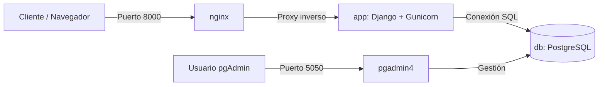

# Aplicación Web con base de datos en contenedores - AE4



## Índice

- [Preparación del Entorno](#preparación-del-entorno)
- [Orquestación con Docker Compose (compose.yml)](#orquestación-con-docker-compose-composeyml)
  - [1. Servicio de Base de Datos (`db`)](#seccion-db)
  - [2. Servicio de Administración (`pgadmin`)](#seccion-pgadmin)
  - [3. Servidor de Aplicaciones Backend (`app`)](#seccion-app)
  - [4. Servidor Web y Proxy Inverso (`nginx`)](#seccion-nginx)
  - [Declaración de Volúmenes Globales](#seccion-volumenes)
- [Automatización con el script de despliegue (`deploy.sh`)](#automatización-con-el-script-de-despliegue-deploysh)
- [Comprobaciones y Generación de Evidencias (`comprobaciones.txt`)](#comprobaciones-y-generación-de-evidencias-comprobacionestxt)
- [Despliegue y Ejecución](#despliegue-y-ejecución)
- [Comprobaciones y Salud (Healthchecks)](#comprobaciones-y-salud-healthchecks)
- [Accesos y Puertos](#accesos-y-puertos)
- [Registrar servidor en pgAdmin](#registrar-servidor-en-pgadmin)
- [Permisos en Directorios Locales (Linux)](#permisos-en-directorios-locales-linux)
- [Incidencias y Resolución de Problemas](#incidencias-y-resolución-de-problemas)
- [Enlace al Repositorio Remoto](#enlace-al-repositorio-remoto)

## Preparación del Entorno

* Crea un fichero `.gitignore` para excluir carpetas innecesarias o ficheros de entorno.

* Crea la carpeta `db` con el script `init.sql`
```sql
-- Datos de ejemplo de la aplicación (TravelRoad adaptada al curso DPL).
-- PostgreSQL ejecuta este fichero UNA sola vez: al inicializar el volumen de
-- datos (carpeta /docker-entrypoint-initdb.d de la imagen oficial de Postgres).
-- Para volver a ejecutarlo desde cero:
--   docker compose down -v && docker compose up -d
--
-- Carga masiva: en un despliegue real los datos llegarían con COPY (ver
-- db/places.csv y la práctica guiada de PostgreSQL); aquí se incluyen unas
-- filas de ejemplo para que el despliegue sea verificable de inmediato.

CREATE TABLE IF NOT EXISTS places (
    id      SERIAL PRIMARY KEY,
    name    VARCHAR(255) NOT NULL,
    visited BOOLEAN NOT NULL DEFAULT FALSE
);

INSERT INTO places (name, visited) VALUES
    ('Tokio', FALSE),
    ('Budapest', TRUE),
    ('Nairobi', FALSE),
    ('Berlín', TRUE),
    ('Lisboa', TRUE),
    ('Denver', FALSE),
    ('Moscú', FALSE),
    ('Oslo', FALSE),
    ('Río', TRUE),
    ('Cincinnati', FALSE),
    ('Helsinki', FALSE);
```

* Preparación del servidor de aplicaciones (`app/`)
    * Se copia la carpeta proporcionada por el material, conteniendo:
        * Dockerfile
        * manage.py
        * requirements.txt (con Django, Gunicorn, psycopg, etc.)
        * Carpetas `config/` y `api/` (con sus respectivas vistas `/`, `/healthz`, `/api/lugares`, etc.)

* Crea la carpeta `nginx/` con el fichero `default.conf` para redirigir el tráfico hacia el servicio de la aplicación:

```conf
server {
    listen 80;
    server_name _;

    location / {
        proxy_pass http://app:8000;
        proxy_set_header Host $host;
        proxy_set_header X-Real-IP $remote_addr;
        proxy_set_header X-Forwarded-For $proxy_add_x_forwarded_for;
    }
}
```

## Orquestación con Docker Compose (compose.yml)

En el archivo `compose.yml` se crea la infraestructura de la aplicación (Base de Datos, Herramienta de Administración, Backend en Django y Servidor Web/Proxy Inverso con Nginx).

El archivo define un proyecto llamado **`dpl-app`** que despliega 4 servicios interconectados dentro de una red interna de Docker Compose:

1. **`db`**: Capa de datos con PostgreSQL.
2. **`pgadmin`**: Interfaz web de administración para la base de datos.
3. **`app`**: Servidor de aplicaciones backend (Django).
4. **`nginx`**: Servidor web, proxy inverso y distribuidor de la SPA del frontend.

<div id="seccion-db"></div>

## 🗄️ 1. Servicio de Base de Datos (`db`)

```yaml
  db:
    image: postgres:16-alpine
    container_name: dpl-db
    environment:
      POSTGRES_DB: travelroad
      POSTGRES_USER: alumno
      POSTGRES_PASSWORD: ${DB_PASSWORD}
    volumes:
      - db-data:/var/lib/postgresql/data # datos persistentes
      - ./db/init.sql:/docker-entrypoint-initdb.d/init.sql:ro  # carga inicial
    healthcheck:
      test: ["CMD-SHELL", "pg_isready -U alumno -d travelroad"]
      interval: 10s
      timeout: 5s
      retries: 5
      start_period: 10s
    restart: unless-stopped
```
### **Propósito:**

* Este servicio levanta el motor de base de datos PostgreSQL para almacenar de forma persistente la información de la aplicación.
* Aislamiento de red: Al no incluir la sección ports, ningún puerto de la base de datos se expone hacia el ordenador anfitrión. 

Esto significa que tu máquina física no puede conectarse directamente desde fuera de Docker a este puerto; solo los demás servicios internos de la red de Docker (como la aplicación Django) pueden acceder a ella utilizando el nombre del servicio (db).

### **Configuración técnica paso a paso**

* `image: postgres:16-alpine`
    * Utiliza la imagen oficial de PostgreSQL versión 16, basada en la variante Alpine. Esta variante es una distribución de Linux ultra ligera y minimalista, lo que reduce drásticamente el peso de la imagen, acelera su descarga y optimiza el uso de recursos.
* `container_name: dpl-db`
    * Asigna un nombre fijo, limpio y personalizado (`dpl-db`) al contenedor. Esto facilita enormemente su identificación y gestión al ejecutar comandos en la terminal (como `docker logs dpl-db` o `docker exec -it dpl-db ...`).
* `environment`: (Variables de entorno)
    * Configuran el comportamiento inicial del motor de base de datos sin necesidad de modificar configuraciones internas:
        * `POSTGRES_DB: travelroad`: Crea automáticamente una base de datos inicial llamada `travelroad` la primera vez que se inicia el contenedor.
        * `POSTGRES_USER: alumno`: Define el nombre de usuario administrador/principal con el que se conectará la aplicación.
        * `POSTGRES_PASSWORD: ${DB_PASSWORD}`: Establece la contraseña del usuario leyendo el valor de forma segura desde una variable de entorno externa (definida en tu archivo `.env` o en el sistema), evitando dejar claves en texto plano dentro del código.
* `volumes`: (Persistencia y configuración inicial)
    * `db-data:/var/lib/postgresql/data`: Conecta un volumen nombrado llamado `db-data` a la ruta interna donde PostgreSQL guarda todos sus registros. Esto garantiza que la información de la base de datos no se pierda aunque apagues o elimines los contenedores con `docker compose down`.
    * `./db/init.sql:/docker-entrypoint-initdb.d/init.sql:ro` # carga inicial: Monta un script SQL local (./db/init.sql) dentro de la carpeta de inicialización automática de Postgres en modo solo lectura (`ro` de read-only). PostgreSQL ejecutará este script de forma automática únicamente la primera vez que se cree el volumen de datos (ideal para poblar esquemas, tablas o datos de prueba iniciales).
* `healthcheck`: (Comprobación de estado)
    * Permite que Docker supervise si la base de datos realmente está operativa y lista para recibir tráfico, evitando que otros servicios dependientes arranquen a tiempo antes de que la base de datos acepte conexiones.
    * `test: ["CMD-SHELL", "pg_isready -U alumno -d travelroad"]`: Ejecuta internamente el comando `pg_isready` para verificar si Postgres ya acepta conexiones para el usuario `alumno` y la base de datos `travelroad`.
    * `interval: 10s`: Realiza una nueva comprobación de salud cada 10 segundos.
    * `timeout: 5s`: Si la prueba tarda más de 5 segundos en responder, se cataloga temporalmente como fallida.
    * `retries: 5`: Si la comprobación falla 5 veces consecutivas, el contenedor cambia su estado a no saludable (`unhealthy`).
    * `start_period: 10s`: Otorga un margen inicial de 10 segundos para que el motor de la base de datos arranque con calma sin penalizar los primeros intentos de verificación.
* `restart`: unless-stopped
    * Política de reinicio automático: El contenedor se reiniciará automáticamente si se produce un fallo inesperado o si se reinicia el sistema Docker, a menos que hayas detenido el servicio de forma manual con un comando de parada explícito.

---

<div id="seccion-pgadmin"></div>

## 📊 2. Servicio de Administración (`pgadmin`)

```yaml
  pgadmin:
    image: dpage/pgadmin4
    container_name: dpl-pgadmin
    environment:
      PGADMIN_DEFAULT_EMAIL: ${PGADMIN_EMAIL}
      PGADMIN_DEFAULT_PASSWORD: ${PGADMIN_PASSWORD}
    volumes:
      - pgadmin-data:/var/lib/pgadmin
    ports: 
      - "5050:80"
    depends_on:
      db:
        condition: service_healthy
    healthcheck:
      test: ["CMD-SHELL", "wget -q -O - http://localhost:80/misc/ping | grep -q PING"]
      interval: 15s
      timeout: 5s
      retries: 5
      start_period: 60s
    restart: unless-stopped
```

### **Propósito:** 
Proporciona una interfaz gráfica web (PgAdmin 4) accesible desde el navegador en el puerto **`5050`** para gestionar visualmente la base de datos PostgreSQL.

* Este servicio despliega pgAdmin 4, una interfaz gráfica web en el puerto **`5050`** que permite gestionar, consultar y visualizar tu base de datos PostgreSQL cómodamente desde el navegador.
* Acceso externo controlado: A diferencia de la base de datos (que está completamente aislada en la red interna), pgAdmin sí expone un puerto hacia el anfitrión (5050:80) para que puedas abrir la interfaz web.

**Configuración técnica paso a paso**

* `image: dpage/pgadmin4`
    * Utiliza la imagen oficial y estándar de pgAdmin 4 mantenida por Dave Page, diseñada específicamente para ejecutarse de forma ligera en contenedores Docker.
* `container_name: dpl-pgadmin`
    * Asigna un nombre fijo y personalizado (`dpl-pgadmin`) al contenedor para identificarlo fácilmente al ejecutar comandos de Docker (como `docker logs dpl-pgadmin`).
* `environment`: (Variables de entorno de acceso)
    * Configuran las credenciales iniciales de administrador con las que podrás iniciar sesión en la interfaz web de pgAdmin:
        * `PGADMIN_DEFAULT_EMAIL: ${PGADMIN_EMAIL}`: Define el correo electrónico de acceso, leyendo su valor de forma segura desde tus variables de entorno externas (como un archivo `.env`).
        * `PGADMIN_DEFAULT_PASSWORD: ${PGADMIN_PASSWORD}`: Define la contraseña maestra de acceso, cargándola también desde el entorno para evitar claves en texto plano.
* `volumes`: (Persistencia de configuración)
    * `pgadmin-data:/var/lib/pgadmin`: Conecta un volumen nombrado llamado `pgadmin-data` a la ruta interna donde pgAdmin almacena sus configuraciones, servidores guardados y preferencias de usuario. Esto garantiza que no pierdas tus conexiones configuradas si apagas o eliminas los contenedores.
* `ports`: (Publicación de puertos)
    * `"5050:80"`: Mapea el puerto 80 interno del contenedor (donde el servidor web de pgAdmin está escuchando) al puerto 5050 de tu máquina anfitriona. Esto significa que puedes entrar a la interfaz gráfica abriendo tu navegador web en: `http://localhost:5050`.
* `depends_on`: (Dependencia de arranque)
    * `db`: con `condition: service_healthy`: Establece que el contenedor de pgAdmin no se iniciará hasta que el servicio de la base de datos (`db`) haya completado su arranque y su `healthcheck` indique que está sano (`healthy`).
* `healthcheck`: (Comprobación de estado)
    * `Supervisa de forma automatizada que el servidor web interno de pgAdmin responda correctamente a las peticiones HTTP.
test: `["CMD-SHELL", "wget -q -O - http://localhost:80/misc/ping | grep -q PING"]`: Ejecuta una solicitud HTTP silenciosa (`wget`) a la ruta interna de diagnóstico `/misc/ping` y busca la palabra clave `PING` mediante `grep` para confirmar que la aplicación web está viva y respondiendo.
    * `interval: 15s`: Realiza la comprobación de salud cada 15 segundos.
    * `timeout: 5s`: Si la respuesta tarda más de 5 segundos, la prueba se cataloga como fallida.
    * `retries: 5`: Si falla 5 veces consecutivas, el contenedor se marca como no saludable (`unhealthy`).
    * `start_period`: 60s: Otorga un margen generoso de 60 segundos (1 minuto) de gracia inicial. Esto es muy útil porque pgAdmin es una aplicación pesada (basada en Python/Flask) y tarda un tiempo prudencial en arrancar por completo la primera vez.
* `restart: unless-stopped`
    * Política de reinicio automático: El contenedor se reiniciará automáticamente ante un fallo inesperado o un reinicio del sistema, a menos que lo hayas detenido de forma manual.

---

<div id="seccion-app"></div>

## ⚙️ 3. Servidor de Aplicaciones Backend (`app`)

```yaml
  app:
    build: ./app
    container_name: dpl-django
    environment:
      APP_MENSAJE: "Hola desde el servidor de aplicaciones DPL (UT4)"
      APP_DATA_DIR: /data
      DB_HOST: db
      DB_NAME: travelroad
      DB_USER: alumno
      DB_PASSWORD: ${DB_PASSWORD}
      LDAP_HOST: ${LDAP_HOST:-}
      LDAP_BASE_DN: "ou=usuarios,dc=dpl,dc=local"
      LDAP_USER_FILTER: "(uid=%s)"
    volumes:
      - ./data:/data
    depends_on:
      db:
        condition: service_healthy
    healthcheck:
      test: ["CMD", "python", "-c", "import urllib.request; urllib.request.urlopen('http://localhost:8000/healthz', timeout=3)"]
      interval: 15s
      timeout: 5s
      retries: 3
      start_period: 10s
    restart: unless-stopped
```

### **Propósito:** 

* Este servicio despliega el backend de la aplicación desarrollado en Django. Es el núcleo que procesa la lógica de negocio, expone los endpoints de la API y conecta la interfaz de usuario con la base de datos y los servicios externos (como LDAP).
* Aislamiento de red: Al igual que la base de datos, no expone puertos directamente hacia tu ordenador anfitrión (el puerto 8000 de Django se queda dentro de la red interna de Docker). Todo el tráfico externo pasa primero de forma segura a través del servidor Nginx (el proxy inverso).

#### **Configuración técnica paso a paso**
* `build: ./app`
    * Indica que la imagen de Docker para este servicio no se descarga de un registro público, sino que se construye localmente utilizando el código y el archivo `Dockerfile` ubicados dentro de la carpeta `./app`.
* `container_name: dpl-django`
    * Asigna un nombre fijo, limpio y personalizado al contenedor para facilitar su identificación y manejo al ejecutar comandos en la terminal (como `docker logs dpl-django`).
* `environment`: (Variables de entorno)
    * Configuran el comportamiento del backend de Django sin necesidad de alterar su código fuente:
        * `APP_MENSAJE` / `APP_DATA_DIR`: Parámetros de configuración interna de la aplicación (como el mensaje de bienvenida y la ruta del directorio de datos).
        * Conexión a PostgreSQL (`DB_HOST`, `DB_NAME`, `DB_USER`, `DB_PASSWORD`): Configuran la conexión a la base de datos apuntando al nombre del servicio db dentro de la red de Docker, reutilizando la contraseña segura mediante ${DB_PASSWORD}.
        * Autenticación LDAP (`LDAP_HOST`, `LDAP_BASE_DN`, `LDAP_USER_FILTER`): Prepara el backend para autenticar usuarios (típico de UT5) contra un servidor de directorio si se define la variable LDAP_HOST. Si no se define, usa el valor por defecto vacío (`${LDAP_HOST:-}`).
* `volumes`: (Persistencia local en el anfitrión)
    * `- ./data:/data`: Realiza un montaje de tipo bind mount. Conecta la carpeta local `./data` de tu ordenador directamente con la ruta `/data` dentro del contenedor. Esto permite que la aplicación guarde archivos que persistirán y podrás editar o consultar directamente desde tu sistema operativo.
* `depends_on`: (Condición de arranque)
    * `db` con `condition: service_healthy`: Establece una dependencia estricta. El contenedor de Django no se iniciará hasta que el servicio de la base de datos (`db`) haya arrancado por completo y su healthcheck confirme que está sano (`healthy`), evitando errores iniciales de conexión rechazada.
* `healthcheck`: (Comprobación de estado)
    * Supervisa automáticamente que el servidor Django esté vivo y respondiendo peticiones web de forma correcta.
    * `test`: Utiliza el propio intérprete de Python de la imagen para ejecutar un script rápido de una línea con `urllib.request` que realiza una petición HTTP GET interna a la ruta de diagnóstico `http://localhost:8000/healthz`, esperando una respuesta con un tiempo límite de 3 segundos.
    * `interval: 15s`: Realiza la prueba de salud cada 15 segundos.
    * `timeout: 5s`: Si la respuesta tarda más de 5 segundos, la comprobación se cataloga como fallida.
    * `retries: 3`: Si falla 3 veces consecutivas, el contenedor se marca oficialmente como no saludable (unhealthy).
    * `start_period: 10s`: Otorga un margen inicial de 10 segundos para que la aplicación Django cargue todas sus dependencias y levante el servidor antes de empezar a penalizar los fallos de salud.
* `restart: unless-stopped`
    * Política de reinicio automático: El contenedor se reiniciará automáticamente si se produce un fallo inesperado o si se reinicia el sistema Docker, a menos que hayas detenido el servicio de forma manual.

---

<div id="seccion-nginx"></div>

## 🌐 4. Servidor Web y Proxy Inverso (`nginx`)

```yaml
  nginx:
    image: nginx:1.27-alpine
    container_name: dpl-nginx
    volumes:
      - ./nginx/default.conf:/etc/nginx/conf.d/default.conf:ro
    ports:
      - "8000:80"
    depends_on:
      app:
        condition: service_healthy
    restart: unless-stopped
```

* **Propósito:** 

Actúa como la única puerta de entrada pública de la arquitectura. Sirve los archivos estáticos de la interfaz frontend (SPA) y reenvía las peticiones dirigidas a `/api/` y `/healthz` hacia el servicio backend (`app`).

* Este servicio despliega Nginx y actúa como la puerta de entrada principal (front-door) de toda tu aplicación.
    * Doble función:
        1. Servidor Web: Se encarga de servir los archivos estáticos de la interfaz gráfica (el frontend compilado con Vite).
        2. Proxy Inverso: Intercepta las peticiones de los usuarios y las redirige inteligentemente: manda el tráfico de `/api/` y `/healthz` hacia el contenedor del backend (app / Django).
    * Punto único de acceso: Es el único servicio que expone un puerto hacia el exterior (`8000`), manteniendo ocultos y protegidos los servicios internos de la red de Docker (Django, PostgreSQL y pgAdmin).

**Configuración técnica paso a paso**

* `image: nginx:1.27-alpine`
    * Utiliza la imagen oficial de Nginx versión 1.27, basada en la variante Alpine (una distribución de Linux minimalista que garantiza un contenedor sumamente ligero, rápido y seguro).
* `container_name: dpl-nginx`
    * Asigna un nombre fijo, limpio y personalizado al contenedor para facilitar su identificación y control en la terminal (por ejemplo, al revisar registros con `docker logs dpl-nginx`).
* `volumes`: (Configuración de enrutamiento)
    * `- ./nginx/default.conf:/etc/nginx/conf.d/default.conf:ro`: Realiza un montaje de tipo bind mount en modo solo lectura (ro de read-only). Toma tu archivo de configuración personalizado local (`./nginx/default.conf`) y lo inyecta directamente dentro de la ruta donde Nginx busca las configuraciones de los servidores virtuales. Aquí es donde se definen las reglas de `try_files` para la SPA y las directivas `proxy_pass` hacia Django.
* `ports`: (Publicación del puerto principal al anfitrión)
    * `- "8000:80"`: Mapea el puerto 80 interno del contenedor (donde Nginx está escuchando las peticiones web) al puerto 8000 de tu máquina anfitriona. Esto significa que para ver la aplicación en tu navegador solo tienes que entrar a: `http://localhost:8000`.
* `depends_on`: (Condición de arranque)
    * `app` con `condition: service_healthy`: Establece una dependencia estricta. El contenedor de Nginx no se iniciará hasta que el servicio de la aplicación (app / Django) haya arrancado por completo y su `healthcheck` confirme que está sano (`healthy`). Esto evita errores molestos de tipo Bad Gateway o Connection Refused si un usuario intenta entrar a la web antes de que el backend esté listo.
* `restart`: unless-stopped
    * Política de reinicio automático: El contenedor se reiniciará de forma automática ante un fallo inesperado o un reinicio del sistema Docker, a menos que hayas detenido el servicio manualmente.

---

<div id="seccion-volumenes"></div>

## 📦 Declaración de Volúmenes Globales

```yaml
volumes:
  db-data:
  pgadmin-data:
```

* Se declaran los volúmenes persistentes gestionados por Docker (`db-data` y `pgadmin-data`) para garantizar que la información de la base de datos y las preferencias de PgAdmin no se pierdan al destruir o recrear los contenedores.

## Automatización con el script de despliegue (`deploy.sh`)

Crea el fichero `deploy.sh` en la raiz del proyecto para automatizar la construcción, arranque y verificación del sistema.

```bash
cat > ~/dpl/ae4/deploy.sh <<'EOF'
#!/usr/bin/env bash
# deploy.sh — reconstruye y verifica el despliegue (curso DPL, UT4).
set -euo pipefail

echo "== Construyendo imagenes =="
docker compose build

echo "== Arrancando servicios =="
docker compose up -d

echo "== Esperando a que /healthz responda 200 =="
for intento in $(seq 1 30); do
  if curl -sf http://localhost:8000/healthz >/dev/null; then
    echo "Despliegue sano tras $intento intento(s)."
    docker compose ps
    exit 0
  fi
  sleep 2
done

echo "ERROR: /healthz no respondio en 60 s" >&2
docker compose logs --tail=20 >&2
exit 1
EOF
chmod +x ~/dpl/ae4/deploy.sh # permisos de ejecución obligatorios
cd ~/dpl/ae4 && ./deploy.sh
```

---

## Comprobaciones y Generación de Evidencias (`comprobaciones.txt`)

Ejecuta o levanta el entorno manualmente y realizando las comprobaciones necesarias guardando sus salidas en `comprobaciones.txt`:

```bash
docker compose up -d
docker compose ps > comprobaciones.txt
curl -I http://localhost:8000/ >> comprobaciones.txt
curl -sf http://localhost:8000/healthz >> comprobaciones.txt
docker compose exec -T db psql -U alumno -d travelroad -c "SELECT count(*) FROM places;" >> comprobaciones.txt
curl -sf http://localhost:8000/api/lugares >> comprobaciones.txt
```

Salida en `comprobaciones.txt`:
```
NAME          IMAGE                COMMAND                  SERVICE   CREATED          STATUS                            PORTS
dpl-db        postgres:16-alpine   "docker-entrypoint.s…"   db        12 seconds ago   Up 11 seconds (healthy)           5432/tcp
dpl-django    dpl-app-app          "gunicorn config.wsg…"   app       12 seconds ago   Up 5 seconds (healthy)            8000/tcp
dpl-nginx     nginx:1.27-alpine    "/docker-entrypoint.…"   nginx     12 seconds ago   Up Less than a second             0.0.0.0:8000->80/tcp, [::]:8000->80/tcp
dpl-pgadmin   dpage/pgadmin4       "/entrypoint.sh"         pgadmin   12 seconds ago   Up 5 seconds (health: starting)   0.0.0.0:5050->80/tcp, [::]:5050->80/tcp
HTTP/1.1 200 OK
Server: nginx/1.27.5
Date: Mon, 26 Oct 2026 09:49:38 GMT
Content-Type: text/html; charset=utf-8
Connection: keep-alive

{"status": "ok", "hostname": "263da214dd2b"} count 
-------
    11
(1 row)

{"lugares": [{"id": 1, "name": "Tokio", "visited": false}, {"id": 2, "name": "Budapest", "visited": true}, {"id": 3, "name": "Nairobi", "visited": false}, {"id": 4, "name": "Berl\u00edn", "visited": true}, {"id": 5, "name": "Lisboa", "visited": true}, {"id": 6, "name": "Denver", "visited": false}, {"id": 7, "name": "Mosc\u00fa", "visited": false}, {"id": 8, "name": "Oslo", "visited": false}, {"id": 9, "name": "R\u00edo", "visited": true}, {"id": 10, "name": "Cincinnati", "visited": false}, {"id": 11, "name": "Helsinki", "visited": false}], "total": 11}
```

---

## Despliegue y Ejecución

1. Desde el directorio del proyecto, levantar los servicios en segundo plano:

```bash
docker compose up -d
```

Salida:
```bash
[+] up 5/5
✔ Network dpl-app_default Created
✔ Container dpl-db Healthy
✔ Container dpl-pgadmin Started
✔ Container dpl-django Healthy
✔ Container dpl-nginx Started
```

2. Verificar el estado de los contenedores y sus healthchecks:

```bash
docker compose ps
```

Salida:
```bash
NAME          IMAGE                COMMAND                  SERVICE   CREATED         STATUS                   PORTS
dpl-db        postgres:16-alpine   "docker-entrypoint.s…"   db        2 minutes ago   Up 2 minutes (healthy)   5432/tcp
dpl-django    dpl-app-app          "gunicorn config.wsg…"   app       2 minutes ago   Up 2 minutes (healthy)   8000/tcp
dpl-nginx     nginx:1.27-alpine    "/docker-entrypoint.…"   nginx     2 minutes ago   Up 2 minutes             0.0.0.0:8000->80/tcp, [::]:8000->80/tcp
dpl-pgadmin   dpage/pgadmin4       "/entrypoint.sh"         pgadmin   2 minutes ago   Up 2 minutes (healthy)   0.0.0.0:5050->80/tcp, [::]:5050->80/tcp
```

---

## Comprobaciones y Salud (Healthchecks)

El sistema implementa comprobaciones de salud automáticas para garantizar el orden correcto de arranque y disponibilidad:
* `db`: Comprueba que PostgreSQL acepta conexiones mediante pg_isready.
* `app`: Valida periódicamente el endpoint /healthz de Django.
* `pgadmin`: Comprueba el servicio web interno de ping.
* `nginx`: Asegura el reenvío correcto del tráfico hacia la aplicación.

## Accesos y Puertos

* Una vez desplegado el sistema, puedes acceder a los servicios a través de los siguientes puertos expuestos en el anfitrión:

    * Aplicación Web (Nginx / Django): http://localhost:8000
    * pgAdmin (Gestor de Base de Datos): http://localhost:5050

## Registrar servidor en pgAdmin

Abre http://localhost:5050 en el navegador e inicia sesión con las credenciales del entorno.

1. Botón derecho sobre **Servers → Register → Server**.
2. Pestaña General: nombre `TravelRoad`.
3. Pestaña **Connection**: rellena los valores de la tabla siguiente.
4. **Save** y navega por **Databases → travelroad → Schemas → public → Tables → places**; con el botón derecho → View/Edit Data puedes ver y editar las filas.

|Campo|	Valor|
|--|--|
Host |name/address|	db
|Port	|5432|
|Maintenance database	|travelroad|
|Username	|alumno|
|Password	|valor de DB_PASSWORD|


## Permisos en Directorios Locales (Linux)

Si el servicio de aplicación (`app`) necesita escribir en el volumen montado en el directorio local `./data`, asegúrate de asignar los permisos correctos al usuario del contenedor:

```bash
sudo chown -R 1000:1000 data
```

## Incidencias y Resolución de Problemas

Durante el desarrollo y despliegue del proyecto, nos encontramos con dos incidencias principales relacionadas con la persistencia, los permisos y el aislamiento de contenedores:

### 1. Conflicto de credenciales / configuración previa en pgAdmin
* **¿Qué pasó?** Al levantar el contenedor de pgAdmin por primera vez, la interfaz web devolvía errores de autenticación o fallaba al arrancar debido a conflictos residuales con volúmenes o credenciales de una caché de Docker anterior en la máquina local.
* **Cómo se resolvió:** Se realizó una limpieza profunda de los contenedores huérfanos y los volúmenes en caché asociados a pgAdmin para forzar un reinicio limpio del servicio, asegurando que el punto de entrada cargase con las variables de entorno configuradas por defecto en el `compose.yml`.

    ```bash
    # 1. Bajar los contenedores y limpiar volúmenes residuales o huérfanos
    docker compose down -v --remove-orphans

    # 2. Reconstruir las imágenes desde cero y levantar el entorno limpio
    ./deploy.sh
    ```

### 2. Bloqueo del contador de visitas (`visitas.txt` estancado en un valor fijo)
* **¿Qué pasó?** El endpoint `/api/visitas` devolvía de forma estática el valor `7` sin incrementar en sucesivas peticiones. Al inspeccionar el sistema, se detectó que el archivo `data/visitas.txt` montado mediante volumen local carecía de los permisos de escritura adecuados para el UID del proceso dentro del contenedor (`1000:1000`), provocando que la aplicación capturase el error de escritura de forma silenciosa y continuase leyendo siempre el mismo valor antiguo.
* **Cómo se resolvió:** 
  1. Se ajustaron los permisos y la propiedad del directorio compartido y del archivo de texto para otorgar acceso de lectura y escritura al usuario UID `1000`:
     ```bash
     sudo chown -R 1000:1000 data/
     sudo chmod 666 data/visitas.txt
     ```
  2. Se validó la correcta persistencia comprobando que el archivo incrementa su valor fluidamente tras reiniciar los servicios (`docker compose restart app`).

## Enlace al Repositorio Remoto
Puedes consultar el código fuente y el historial de commits en el siguiente repositorio:
- [GitHub - AE4](https://github.com/manuelgm92/ae4)